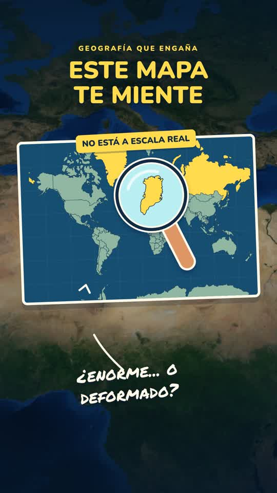

# Este mapa te miente

Video de mapas animados con stickers y narración suministrada por el usuario.

- Duración: 35,47 segundos.
- Resolución: 1080 × 1920 (vertical 9:16).
- Fotogramas: 30 fps.
- Audio: voz original, música y efectos; mezcla final a −16 LUFS.
- Subtítulos incorporados y archivo SRT independiente.

[Descargar el video](este-mapa-te-miente.mp4) · [Subtítulos](este-mapa-te-miente.srt)

Las comparaciones utilizan superficies aproximadas. Rusia equivale a unos 17,10 millones de km² y África a 30,37 millones de km²: aproximadamente 1,8 Rusias. La comparación europea utiliza Francia metropolitana. Las bandas dentro de África representan sumas de superficies, no un encaje exacto de fronteras.

SHA-256 del MP4: `b7ebf2a9e1332f18f854f49bb003d86ad10b146cf1792b3d32676e35468f0c0f`.

Verificado: MP4 completo, 1065 fotogramas y audio decodificados sin errores.
