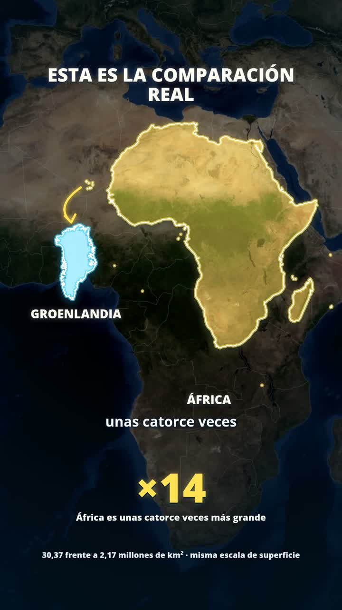

# Este mapa te miente — versión 2

Reedición del video siguiendo las referencias visuales aportadas por el usuario: mapa satelital a pantalla completa, acercamientos, paneos, fronteras luminosas, texturas de terreno y sonido sincronizado.

[Descargar video MP4](este-mapa-te-miente-v2.mp4) · [Subtítulos SRT](este-mapa-te-miente-v2.srt)

- Vertical 1080×1920, 30 fps y 35,5 segundos.
- Narración original completa de 35,47 segundos.
- 31 señales de sonido ligadas a movimientos de cámara, aparición de territorios y datos.
- Mezcla final: −16,1 LUFS; pico real: −2,4 dBFS.
- Subtítulos incorporados y archivo SRT independiente.

Las comparaciones utilizan superficies aproximadas. Las siluetas comparativas comparten escala de área; la suma de Estados Unidos, China e India representa superficies y no un encaje exacto de fronteras. La comparación europea usa Francia metropolitana.

La primera entrega permanece disponible [aquí](../este-mapa-te-miente.mp4).

Verificación de esta copia: 1065 fotogramas y audio decodificados sin errores, contenedor MP4 íntegro y sin intervalos negros detectados.

SHA-256: `ded4ace79d74af20e6e58cbe0659aef931f98aabb2e2733b3e8aedbc4ac08d8a`.
